# DevOps Engineer Local Environment Setup: Git, VS Code, GitHub, AWS, Azure, AWS CLI, Azure CLI# DevOps Environment Setup: Setup Logic Documentation

**Author:** Ifeanyi Mathew Duru
**Host:** Windows laptop running Oracle VirtualBox
**Guest VM:** Ubuntu 26.04.1 LTS (hostname `labs`, kernel 7.0.0-43-generic), accessed over SSH
**VM resources:** 5 CPUs · 4.9 GB RAM · 12 GB disk    


## 1. Summary

This document describes how the DevOps toolchain was installed on an Ubuntu VM, which package managers were used, and how the network problems met along the way were diagnosed and solved.

The VM's network connection inside VirtualBox was unreliable for large downloads (stalls, resets, DNS failures), even though the host laptop's connection was fine. To work around this, I adopted a **"download on the host, verify, transfer" workflow**: large binaries were downloaded in the laptop's browser, copied to the VM with `scp`, and **verified against the official SHA-256 checksums on the VM before installing**. For the local Kubernetes cluster, this led to choosing **K3s with an air-gapped install** instead of Minikube.

---

## 2. Tools installed

| Tool | Version | Purpose | Installed with |
|---|---|---|---|
| VS Code | <1.147.0> | IDE (on host laptop), connected to the VM via Remote-SSH | Official Windows installer from code.visualstudio.com |
| GitHub | – | Remote Git hosting | Account with SSH key authentication from the VM |
| Git | <2.53.0> | Version control | `apt` |
| Docker Engine | 29.9.3 | Container runtime | `apt` (Docker's official repository) |
| kubectl | v1.37.2 | Kubernetes command-line client | Binary downloaded via host browser, SHA-256 verified, `install` to `/usr/local/bin` |
| K3s | v1.37.2+k3s1 | Local single-node Kubernetes cluster | Air-gapped install: binary + image bundle downloaded via host browser, SHA-256 verified, `INSTALL_K3S_SKIP_DOWNLOAD=true` |
| Minikube |  | Local Kubernetes (originally planned) | Binary downloaded via host browser, SHA-256 verified. Installed, but cluster start was blocked by the VM network 
| Helm | <v4.3.2> | Kubernetes package manager | Release archive downloaded via host browser, SHA-256 verified, extracted and installed |
| AWS CLI v2 | <2.40.2> | Manage AWS from the terminal | Official zip downloaded via host browser, integrity-tested with `unzip -t`, official installer |
| Azure CLI | <2.93.0> | Manage Azure from the terminal | Microsoft install script (adds Microsoft's `apt` repository) |
| Node.js / npm | <24.22.3> | JavaScript runtime and package manager | Official Node.js LTS binary downloaded via host browser, verified against `SHASUMS256.txt`, extracted to `/usr/local` |
| jq | <jq-1.8.1> | JSON processing | `apt` |
| Terraform | <1.17.2> | Infrastructure as Code | Official HashiCorp binary downloaded via host browser, verified against `SHA256SUMS` |
| Ansible | <2.20.1> | Configuration management | `apt` (Ubuntu repository) |


## 3. Package managers and install methods

- **apt (primary system package manager):** used for Git, Docker, jq, Ansible, unzip and the Azure CLI. Third-party repositories (Docker, Microsoft) were added with their GPG signing keys so apt can verify the packages. To survive connection drops, apt was configured to retry downloads:
  `echo 'Acquire::Retries "10";' | sudo tee /etc/apt/apt.conf.d/80-retries`
- **Verified binary installs:** kubectl, K3s, Minikube, Helm, Terraform and Node.js are distributed as standalone binaries or archives. Each was checked with `sha256sum --check` against the vendor's published checksum, then placed in `/usr/local/bin` with `sudo install`.
- **Vendor installers:** the AWS CLI (bundled `./aws/install`), the Azure CLI (Microsoft script) and K3s (`install.sh`, run offline) use their official installers.
- **npm:** available for Node-based CLIs (optional AI tools).

---

## 4. Local Kubernetes cluster (K3s, air-gapped)

| Item | Value |
|---|---|
| Distribution | K3s v1.37.2+k3s1 (CNCF-certified Kubernetes) |
| Node | `labs`, status **Ready**, role control-plane |
| Container runtime | containerd 2.3.7-k3s1 |
| System pods | coredns, local-path-provisioner, metrics-server, traefik, svclb-traefik: all Running |

**Install steps (VM side):**
```bash
sha256sum --check --ignore-missing sha256sum-amd64.txt          # verify k3s + image bundle
sudo mkdir -p /var/lib/rancher/k3s/agent/images/
sudo cp k3s-airgap-images-amd64.tar.zst /var/lib/rancher/k3s/agent/images/   # preload images
sudo install -m 755 k3s /usr/local/bin/k3s
sudo INSTALL_K3S_SKIP_DOWNLOAD=true ./install.sh                  # offline install, creates systemd service
mkdir -p ~/.kube && sudo cp /etc/rancher/k3s/k3s.yaml ~/.kube/config
sudo chown $USER:$USER ~/.kube/config && chmod 600 ~/.kube/config
kubectl get nodes -o wide                                        # labs   Ready   control-plane
```

---

## 5. Troubleshooting log

| # | Problem | Cause | Fix |
|---|---|---|---|
| 1 | `sha256sum --check` → `kubectl: FAILED` | Incomplete download | Re-downloaded; learned to always verify before installing |
| 2 | `curl: (92) HTTP/2 stream … PROTOCOL_ERROR` | HTTP/2 stream broken by the unstable connection | Forced HTTP/1.1 (`--http1.1`) and added `--retry` |
| 3 | `curl: (6) Could not resolve host: dl.k8s.io` | Intermittent DNS failure in the VM | Set public DNS for systemd-resolved (`DNS=8.8.8.8 1.1.1.1` in `/etc/systemd/resolved.conf.d/dns.conf`), restarted `systemd-resolved`, confirmed with `nslookup` |
| 4 | Downloads stalling | Possible IPv6 routing issue | Forced IPv4 (`curl -4`) and resumed partial files (`-C -`) |
| 5 | `curl: (56) Recv failure: Connection reset by peer` | Connection dropping on large downloads | Retry loop: `until curl … -C - …; do sleep 5; done` |
| 6 | `client_loop: send disconnect: Connection reset` | The SSH session itself dropped, killing the running command | Ran long tasks inside `tmux` so they survive SSH disconnects |
| 7 | `Segmentation fault` running kubectl | The `scp` copy was cut off, so the binary was corrupt (hash mismatch) | Re-copied, confirmed `sha256sum` matched, reinstalled |
| 8 | Large downloads on the VM kept failing | VirtualBox VM network path unreliable (not the ISP: the problem continued across several ISPs while the host's browser downloads worked) | Adopted the host-browser → verify → `scp` → verify-again workflow for every large binary |
| 9 | `minikube start --driver=docker` repeatedly stalled midway | Minikube must pull several hundred MB of images over the VM's network; no offline option | Tried retries and `minikube delete` + fresh start. **Switched to K3s**, which supports a fully air-gapped install: all files were downloaded via the host browser, so the cluster started with no internet needed on the VM |
| 10 | kubectl v1.34.2 vs cluster v1.37.2 version-skew warning | kubectl is only supported within ±1 minor version of the cluster | Downloaded kubectl v1.37.2 via the host browser, verified, replaced the binary |
| 11 | K3s log errors (`Slow SQL`, `read version … is not as new as written version`) | Slow VM disk and normal startup retries | No action needed; confirmed node `Ready` and all system pods `Running` / `Completed` |


## 6. Security hardening (Step 8)

- `chmod 700 ~/.ssh`, `chmod 600 ~/.ssh/id_ed25519`, `chmod 600 ~/.kube/config`: private keys and cluster credentials are readable only by the owner.
- UFW firewall enabled. SSH was allowed **before** enabling, plus the K3s ports and internal networks:
  ```bash
  sudo ufw allow OpenSSH
  sudo ufw allow 6443/tcp                     # Kubernetes API
  sudo ufw allow from 10.42.0.0/16 to any     # K3s pod network
  sudo ufw allow from 10.43.0.0/16 to any     # K3s service network
  sudo ufw enable
  ```
- Note: the course's verification script checks for a running Minikube cluster. With K3s it may report a WARN/FAIL for that check. The cluster is running and verified with `kubectl get nodes` 

---

## 7. Lessons learned

- **Verify every download.** A partial file can look normal but crash when run (segfault). `sha256sum --check` catches it.
- **Read error messages by layer.** HTTP/2, DNS, TCP resets and SSH drops looked like different problems but had one root cause: the VM's network path.
- **Isolate before you fix.** Changing ISPs didn't help while the host downloaded fine, which pointed to the VM, not the internet.
- **Choose tools that fit the constraint.** K3s's air-gapped install removed the network dependency entirely, and it still meets the "Minikube or similar local distribution" requirement.
- `tmux`, `curl -C -`, `--retry` and apt retries make a fragile connection workable.

## 7a. IDE and cloud accounts

### VS Code
VS Code is installed on the Windows host with DevOps extensions (Remote-SSH, Docker, Kubernetes, HashiCorp Terraform, YAML, AWS Toolkit, Azure). It connects to the Ubuntu VM via **Remote-SSH**, so files on the VM are edited directly. To work around the VM's network limits, `remote.SSH.localServerDownload` was set to `always`: the VS Code Server is downloaded by the host and copied to the VM over SSH.

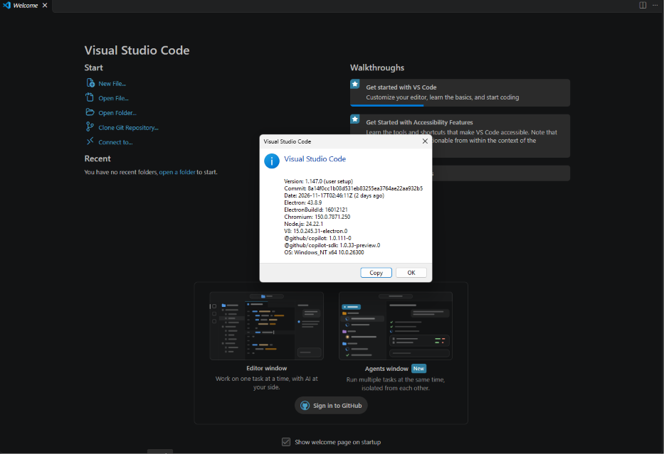
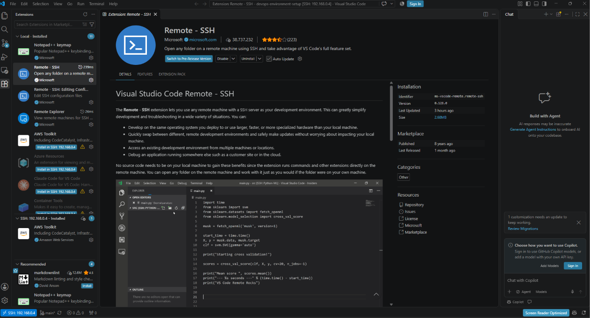
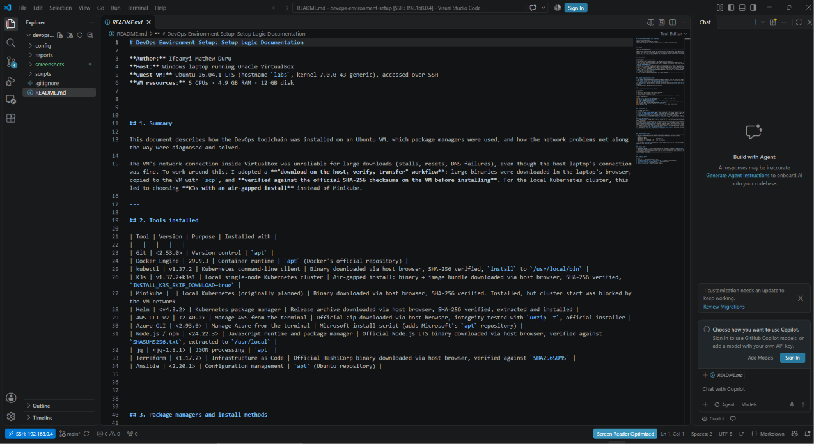
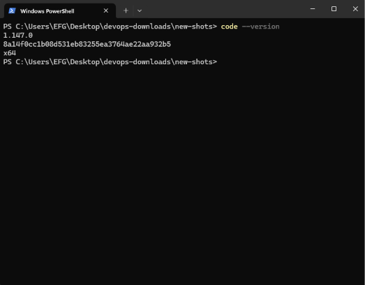

### GitHub
Signed-in account, and SSH key authentication from the VM (`ssh -T git@github.com`).


### AWS
- Root account protected with **MFA**; a **zero-spend budget** alerts on any cost.
- CLI access uses a dedicated IAM user **`ifeanyi-cli`** with **ReadOnlyAccess** (least privilege; root keys are never used).
- Credentials are stored in `~/.aws/credentials` (permissions `600`) and are excluded from Git via `.gitignore`.
- Verified with `aws sts get-caller-identity`.

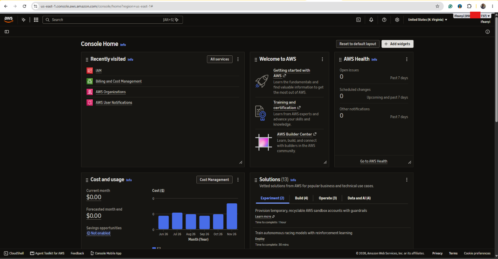
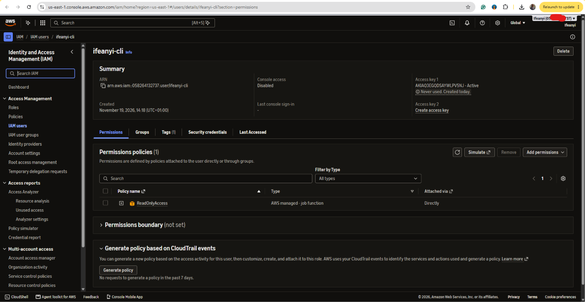
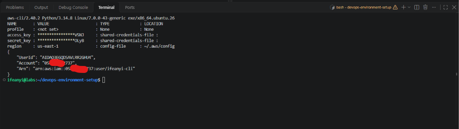

### Azure
Signed in to the Azure Portal. The CLI is authenticated with `az login --use-device-code` (the VM has no browser, so the code is entered on the host) and verified with `az account show`.

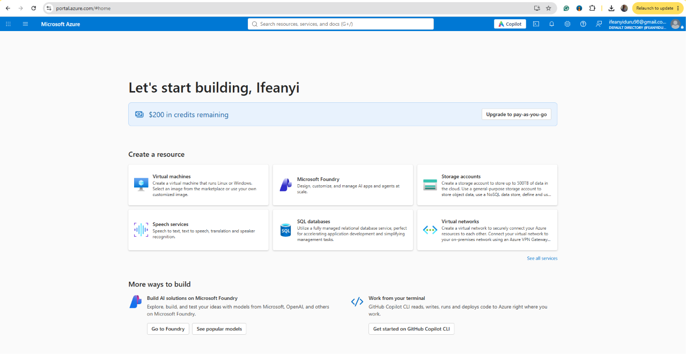
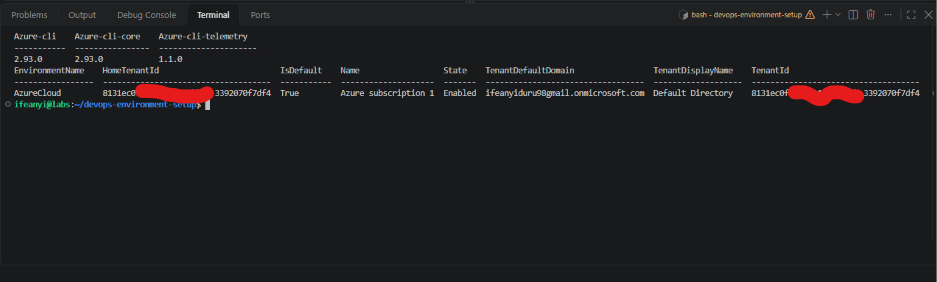

> Account IDs, subscription IDs and emails are partly masked in screenshots. No credentials are stored in this repository.


--


## 8. Evidence

### Tooling versions
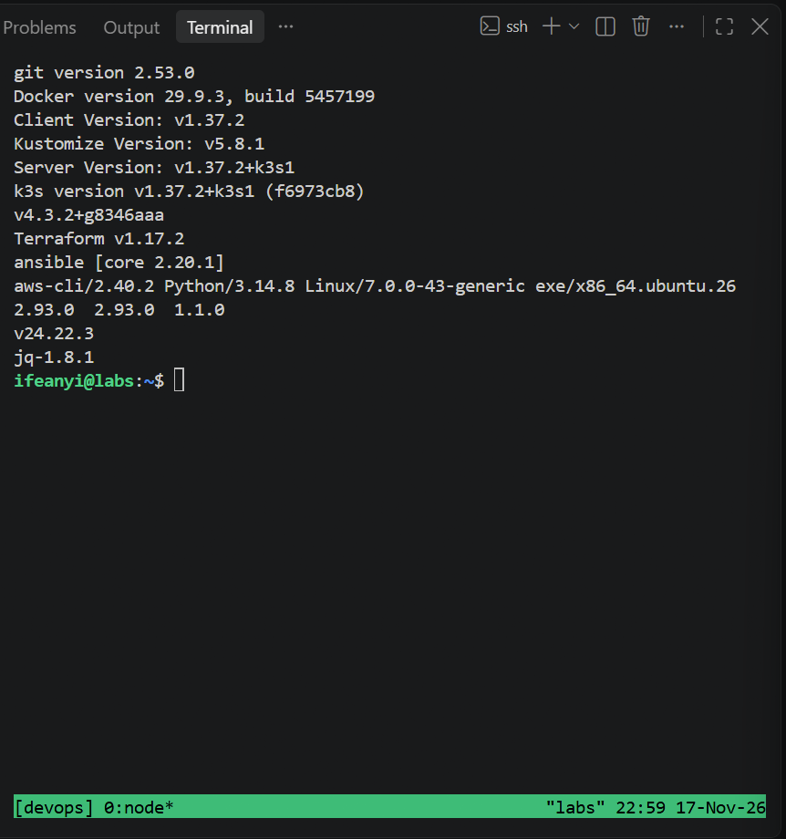

### Local cluster: K3s node Ready
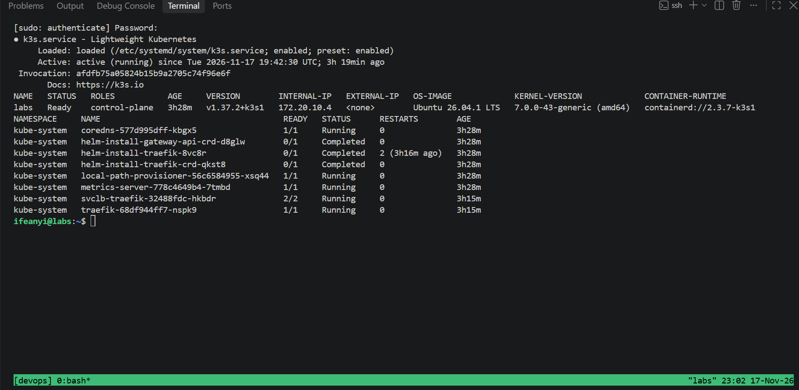

### Course verification script summary
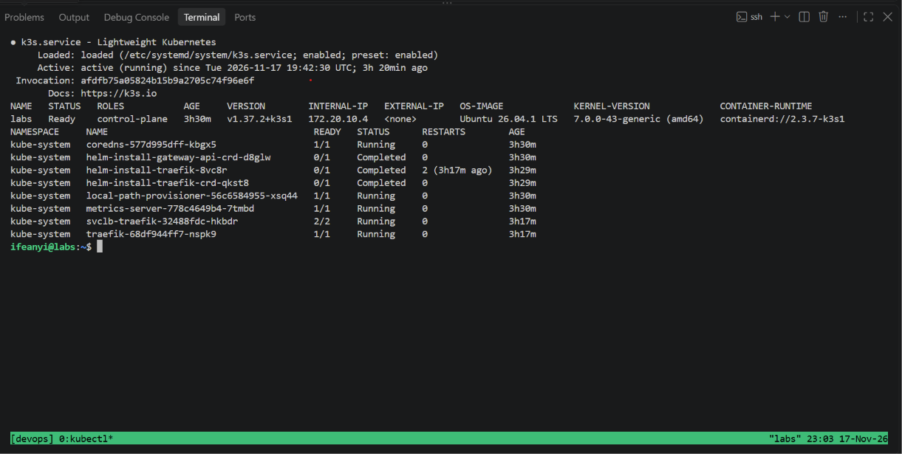

---

## 9. Repository structure

| Path | Purpose |
|---|---|
| [`README.md`](README.md) | Deliverable 4: setup logic documentation (this file) |
| [`config/.bashrc`](config/.bashrc) | Deliverable 1: environment configuration file |
| [`reports/tooling-verification-report.txt`](reports/tooling-verification-report.txt) | Deliverable 2: tooling verification report |
| [`reports/local-cluster-proof.txt`](reports/local-cluster-proof.txt) | Deliverable 3: local cluster proof |
| [`scripts/collect-evidence.sh`](scripts/collect-evidence.sh) | Script used to generate the reports |
| [`screenshots/`](screenshots/) | Visual evidence (tooling, cluster, VS Code, GitHub, AWS, Azure) |
| [`.gitignore`](.gitignore) | Keeps credentials and editor backup files out of Git |
